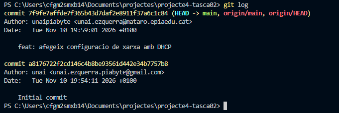
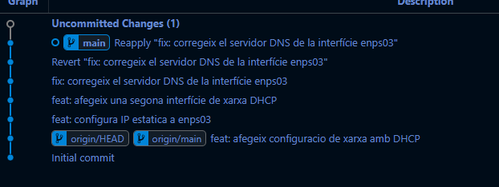
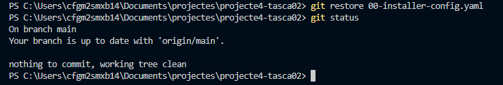
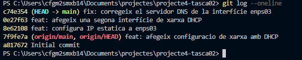
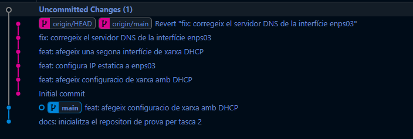

# Solucions - Tasca 02: Historial de versions

## Part 1. Bones pràctiques en els commits

S'ha creat el repositori projecte4-tasca02 i s'ha configurat la identitat de Git.

S'han creat els fitxers README.md i 00-installer-config.yaml i s'han realitzat dos commits seguint les convencions establertes.

## Part 2. Historial del repositori

S'ha consultat l'historial complet amb git log i la versió resumida amb git log --oneline.

També s'ha utilitzat Git Graph de VS Code per visualitzar els commits i git show HEAD per inspeccionar els canvis de l'últim commit.

## Part 3. Recuperar versions del Working Directory

S'ha modificat el fitxer 00-installer-config.yaml canviant la interfície enps03 per eth0.

Amb git status s'ha comprovat que el fitxer estava modificat. Després s'ha executat git restore per recuperar la versió anterior.

Finalment, git status ha mostrat que el repositori estava net.

## Part 4. Recuperar versions anteriors

### Creació de nous commits

S'han creat tres commits modificant la configuració de xarxa:

- Configuració d'una IP estàtica.
- Incorporació d'una segona interfície.
- Modificació del servidor DNS.

### Git revert

S'ha utilitzat git revert per desfer els tres últims commits originals i recuperar la configuració DHCP inicial, mantenint l'historial de canvis.

### Explorar un commit anterior

Amb Git Graph s'ha seleccionat el quart commit per observar les diferències respecte al commit anterior.

Les línies verdes indiquen les insercions i les vermelles les eliminacions.

### Git reset

Finalment, s'ha utilitzat git reset --hard HEAD~1 per eliminar l'últim commit.

## Conclusió

Amb aquesta activitat he après a consultar l'historial de Git, identificar els canvis realitzats i recuperar versions anteriors dels fitxers i commits. També he practicat les diferències entre git restore, git revert i git reset.
